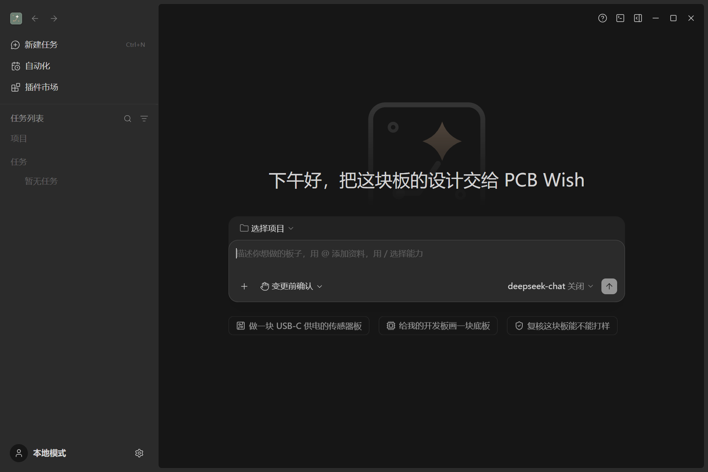
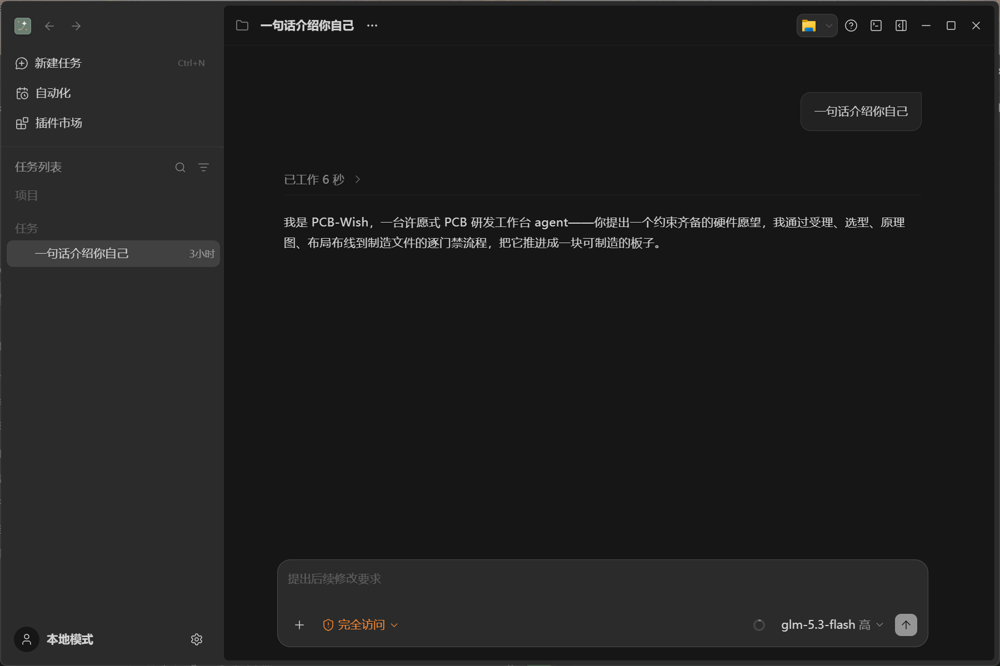
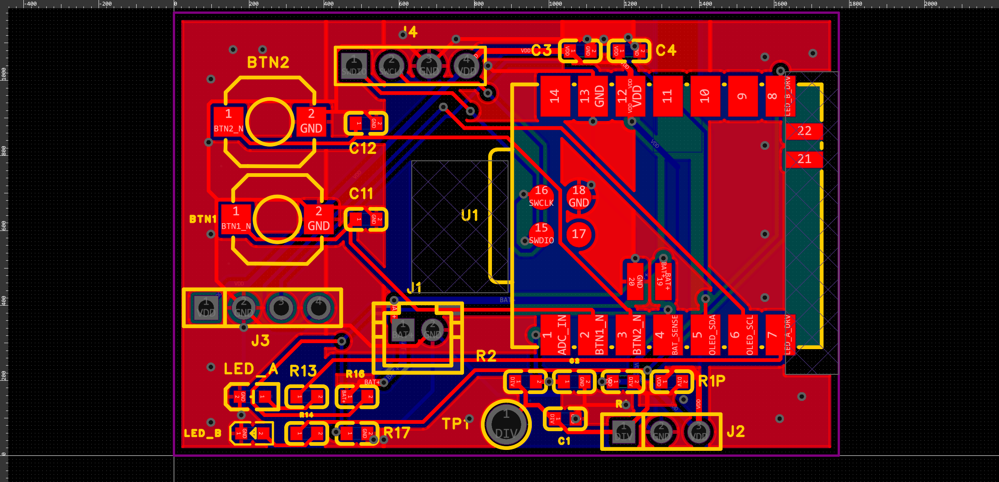
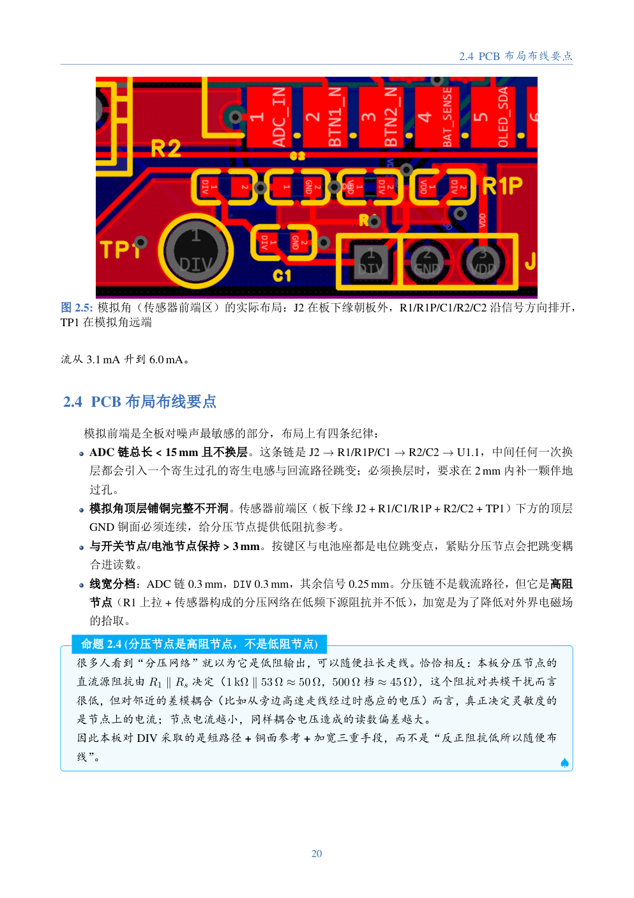

# PCB-Wish

<p align="center">
  <a href="docs/readme/images/app-home.png">
    
  </a>
</p>

<p align="center">
  <strong>从自然语言需求到可制造 PCB 的智能体工作台</strong><br>
  Windows 10/11 · v3.16.2 · 本地运行 · 自定义 API Key
</p>

<p align="center">
  简体中文 | <a href="README.en.md">English</a> · <a href="README.pdf">完整报告 PDF</a> · <a href="README.tex">LaTeX 源码</a>
</p>

PCB-Wish 是一个面向 PCB 设计的桌面智能体系统。用户用自然语言描述硬件目标，系统完成需求澄清、器件选型、原理图设计、PCB 布局布线、检查验证，最终输出 Gerber、钻孔、BOM、贴片坐标和检查报告。用户明确要求教学讲义后，系统还会在制造文件完成后生成 LaTeX 排版的 PDF 讲义。

项目基于 ZCode 桌面端构建，领域插件位于 `apps/zcode-cli/packages/pcb-wish-plugin/`，设计执行依赖嘉立创EDA专业版（LCEDA Pro）。

## 创作背景

用户用自然语言描述一块绘制难度不大的目标板卡，agent 系统通过分阶段工作完成需求澄清、选型、原理图与 PCB 绘制和检查验证，并导出可交付制造的工程文件；用户显式要求时还会生成配套教学讲义。

它的灵感来源于工科创课程的教学全过程。工科创课程中已经涉及电子设计、板卡绘制等内容，但无法覆盖每个人的需求和兴趣。

笔者更希望它成为一个兴趣驱动的学习工具，让同系大多数同学在修读工科创、并具备一定电子基础后，能够借助大模型工具完整尝试制作一块自己感兴趣功能的板卡，并在项目过程中学习电子设计的数值计算、元器件选型等方法，自主进行项目式学习。

笔者受此启发，希望借助当下发展迅速的大模型，把电子设计学习与同学们感兴趣的项目结合起来。通过开发这个 agent，既希望帮助同学们把设计想法落地，也希望通过随附讲义辅助同学们完成学习。系统工作流来源于笔者完整的打板流程，项目也尝试把“AI+教与学”落在这一过程中。

## 核心能力

- **对话式受理。** 用日常语言描述板卡；系统集中列出影响设计的缺口，最多两轮提问，并生成可机器校验的 `MISSION.md`。
- **分阶段门禁。** 按 G0–G7 逐门推进，每道门都要求证据文件；未通过时修正或暂停，不带着缺口进入下一阶段。
- **独立质检。** 质检由独立智能体只读复核：重读画布、执行网表检查、解析 Gerber，不采信设计角色的口头结论。
- **EDA 执行。** 驱动嘉立创EDA专业版完成建库、原理图、布局、布线、铺铜与丝印，并导出制造文件。
- **制造交付。** 输出 Gerber、钻孔、BOM、贴片坐标、装配说明与检查报告，交付路径为 `projects/<slug>/export/`。
- **教学讲义。** 仅当用户显式要求时生成：总览加模块章，逐章讲解工作原理、设计依据、布局布线与验证结果。
- **可追溯。** 决策日志、门禁状态与验证记录落盘到 `logs/`、`reports/`，作为设计、复核与讲义的事实来源。

## 工作流程

```text
需求
  │
  ▼
受理 + 选型（G0 / G0.5）
  │
  ▼
设计（G1–G5.5）
  │
  ▼
独立质检（G6）
  │
  ▼
交付：Gerber、钻孔、BOM、贴片坐标、检查报告
  └── 教学讲义（G7，用户显式要求时）
```

`MISSION.md` 是项目唯一事实源；门禁状态记录在 `projects/<slug>/reports/gates.json`，每道门都有对应的证据文件与检查记录。

<p align="center">
  <a href="docs/readme/images/app-conversation.png">
    
  </a>
</p>

<p align="center"><sub>左侧任务列表，右侧自然语言输入、智能体回复与模型选择。</sub></p>

## 快速开始

1. 准备 Windows 10/11 64 位、嘉立创EDA专业版（≥ 4.1.60）、Python 3.10+。
2. 使用 `PCB-Wish-3.16.2-win-x64.exe` 安装，或运行免安装目录中的 `PCB-Wish.exe`。
3. 首次启动填写 API Key。接口需兼容 OpenAI，模型需支持工具调用，上下文建议 1M；配置仅保存在本机。
4. 选择工作区，用自然语言描述板卡；系统会集中提问并补齐设计缺口。
5. 设计按 G0–G7 推进；交付物位于 `projects/<slug>/export/`，交付说明为 `reports/DELIVERY_FINAL.md`。

从源码运行桌面端：

```bash
pnpm bootstrap
pnpm dev:desktop
```

## 测试案例：FlexiHeal v2

FlexiHeal v2 是目前唯一一次从需求推进到制造文件、再生成教学讲义的完整测试。任务书要求设计一块柔性弯曲传感器角度测量板：把传感器 53–90 Ω 的电阻变化转换为 0–3.3 V 电压送入 ADC，支持 USB/锂电池供电与充电、OLED 接口、0°/90° 校准按键和调试口，并由委托方手工焊接。

<p align="center">
  <a href="docs/readme/images/board-pour.png">
    
  </a>
</p>

<p align="center"><sub>FlexiHeal v2 顶层铺铜完成图（红：顶层铜；蓝：底层铜；黄：丝印与焊盘）。</sub></p>

该案例产出了 Gerber、钻孔、BOM、贴片坐标、装配说明、检查报告与 58 页讲义，制造文件经过两路独立复核。本次测试仅使用该项目的任务书作为需求输入，不代表测试结果已交付或投入使用。

## 教学讲义

教学讲义不是默认交付物。只有用户在受理阶段用显式语言要求教学讲义，它才会进入 `MISSION.md` 的交付物清单；若无显式说明，受理智能体可能回问是否需要，未确认或未选择时不生成，并在交付说明中注明。用户要求讲义后，系统在板卡通过 G6 后生成 PDF。

当前讲义为 1 章总览加 7 个功能模块章，每章按“内容提要、工作原理、设计依据与计算、PCB 布局布线要点、验证方法与结果”展开。FlexiHeal v2 讲义共 58 页、27 张真实工程图，关键数字尽量对应到实测、计算或仿真记录。

<p align="center">
  <a href="docs/readme/images/lecture-sample.png">
    
  </a>
</p>

<p align="center"><sub>FlexiHeal v2 讲义示例页：PCB 布局要点与工程实例图。</sub></p>

## 适用范围与当前边界

- 适用范围：2–4 层、低速数字与模拟、中小密度板卡；射频、高速、盲埋孔需求会建议简化或分期。
- 布线以自动布线为主，辅以脚本修补；美观度、成本、电磁兼容、热设计等仍需工程判断。
- 下单、付款、对外沟通与最终签字由用户负责；投产前需复核封装、极性、BOM，并完成嘉立创 DFM 检查。
- 受预算限制，目前完成一次完整的人工在环测试（FlexiHeal v2）；完全无人干预的完整流程尚待验证。教学讲义仅展示默认技能包的产出，其他开源技能包的组合效果尚未展示。

## 仓库结构

- `apps/zcode-cli/packages/pcb-wish-plugin/`：PCB-Wish 领域插件，包含智能体、技能、门禁与 EDA 脚本。
- `apps/`：桌面端与命令行应用。
- `packages/`：共享运行时与基础设施。
- `docs/readme/`：报告图片与构建产物。

## 文档

- [README.pdf](README.pdf)：完整报告
- [README.tex](README.tex)：LaTeX 源码
- [插件技术说明](apps/zcode-cli/packages/pcb-wish-plugin/README.md)
- [docs/readme/images](docs/readme/images)：界面、PCB 与讲义图片

## 许可与致谢

桌面端第一方代码沿用上游 [ZCode](https://github.com/zai-org/ZCode) 的 Apache-2.0 许可；PCB-Wish 插件为 MIT；第三方组件遵循各自许可。设计执行依赖嘉立创EDA专业版，讲义由 XeLaTeX 排版。感谢 FlexiHeal 项目的委托方提供真实任务书、验收意见与修改建议。
